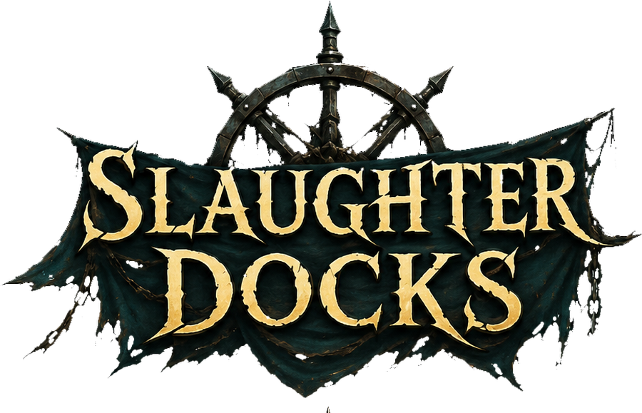

### Hunt leviathans. Haul them home. Try to make it back.

*A first-person monster-hunting voyage on an open, hostile sea.*

---

The sea is full of things worth more dead than alive. You have a boat, a harpoon,
and a contract pinned to a board at the docks. What you do not have is a crew that
trusts you, a hull that can take a hit, or any guarantee that the thing you are
hunting isn't hunting you back.

**Slaughter Docks** is about the whole voyage — not just the kill. Finding the
monster is a skill. Killing it is a fight. Getting the carcass home before it rots,
before the scavengers smell it, before your overloaded ship rolls over in a swell —
that's the part that actually pays.

## See it in motion

<!--
  TO ADD VIDEOS: open this file on github.com, click the pencil (Edit), then
  DRAG the .mp4 straight into the editor. GitHub uploads it and pastes a link.
  Do this from THIS public repo - attachments uploaded to a private repo 404
  for everyone else.

  Your recordings are at:
    C:\Users\Asim\Downloads\Game1.mp4
    C:\Users\Asim\Videos\Captures\first (1).mp4
    C:\Users\Asim\Videos\Captures\first (2).mp4
-->

## The voyage

**Read the water.** Monsters don't sit on a map marker waiting for you. They leave
traces — a slick of oil, a torn fin, a half-eaten kill drifting in the current. Every
sign is old by the time you find it, so you're never chasing the creature. You're
chasing where it *was*, and guessing where it went.

**Sail it properly.** Wind is the engine. Catch it right and the sails pull hard;
catch it wrong and you're crawling broadside while something circles below. Gusts
shift, the sea moves, and the helm needs hands on it.

**Find the opening.** Every species is armoured differently, and hitting the wrong
plate with the wrong weapon just makes it angry. The opening isn't a glowing weak
spot — it's a *moment*. A lunge that overextends. A breach that exposes a flank.
Miss it and you wait for the next one.

**They remember you.** Wound something badly enough and it will break off and run
rather than die. It heals. It earns a name. And when you meet it again it has learned
what nearly killed it — and that weapon won't work as well twice.

**Then comes the hard part.** A dead leviathan is tonnes of meat you now have to crane
aboard and lash down. It slows the ship. It bleeds into the water. Scavengers follow
the scent, and some of them are happy to eat your cargo straight off the deck. The
carcass is rotting the entire way home, and the dockmaster pays for condition.

**Spend it before you lose it.** Gold buys hulls, and each ship upgrades on its own
terms. Monster parts become weapons, poisons and provisions. Coin hires crew to work
the cannons while you steer. Then the board has another contract, and the tide is going out.

## Status

In active development by one person. The core voyage — sailing, tracking, hunting,
recovery, the port economy — is playable end to end. Expect rough edges, placeholder
art and systems still being tuned.

Builds are published under [Releases](../../releases) when they're worth playing.

## Built with

Unity 6 and HDRP. Original systems for sailing, wind, monster behaviour, tracking,
cargo and crew.

---

**Slaughter Docks** © Asim Yılmaz. All rights reserved. 
Source code is kept in a private repository.

